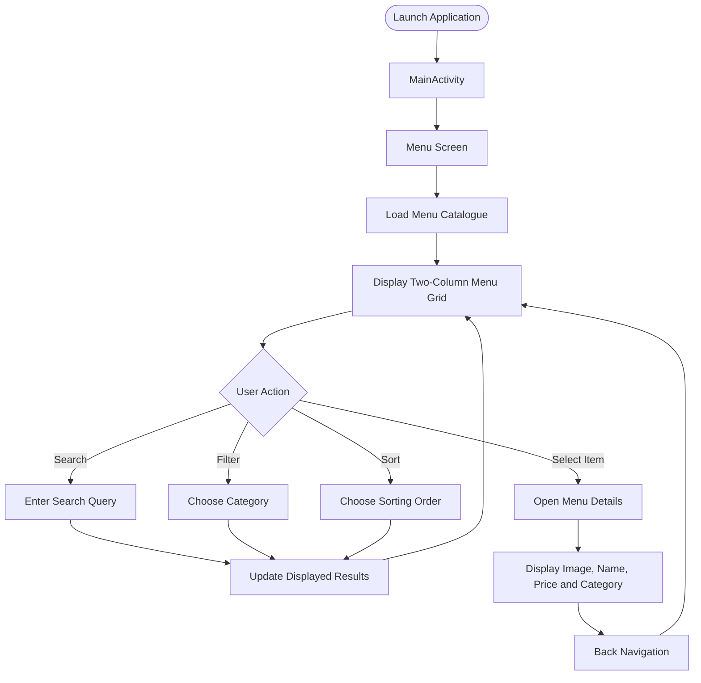
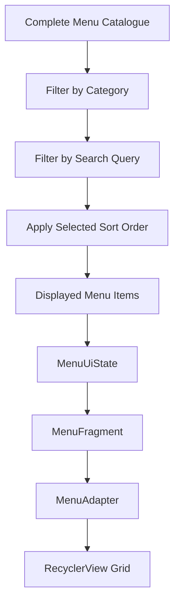
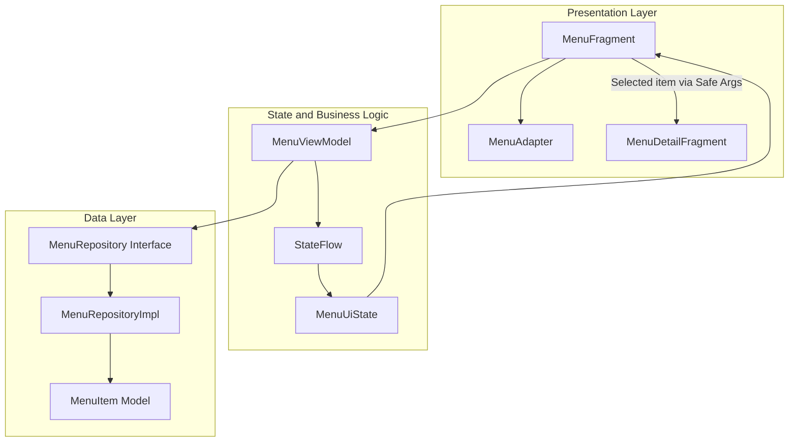

# Little Lemon 🍋
### A Native Android Restaurant Menu Application

Little Lemon is a Kotlin-based Android application for exploring a restaurant menu. It presents menu items in a two-column grid and lets users search, filter, and sort the catalogue before opening an individual item’s detail screen.

The project demonstrates a maintainable Android implementation using **MVVM, Kotlin Coroutines and Flow, StateFlow, the Repository pattern, View Binding, RecyclerView, and the Navigation Component**.

---

## Table of Contents

- [Overview](#overview)
- [Features](#features)
- [Application Screens and User Flow](#application-screens-and-user-flow)
- [Architecture](#architecture)
- [Menu Data and Behaviour](#menu-data-and-behaviour)
- [Technology Stack](#technology-stack)
- [Project Structure](#project-structure)
- [Testing](#testing)
- [Build and Run](#build-and-run)
- [Current Scope](#current-scope)
- [Future Enhancements](#future-enhancements)

---

## Overview

The application starts on the menu screen, where users can browse a collection of food, drinks, and desserts. Menu items are displayed in a scrollable two-column grid with images. Users can search by item name, choose a category filter, and select a sorting order.

Selecting a menu item opens a dedicated detail screen that displays its image, name, price, and category.

### Menu catalogue

The current local catalogue contains 10 menu items:

| Category | Items |
|---|---|
| Drinks | Latte, Mocha |
| Food | Boeuf bourguignon, Bouillabaisse, Lasagna, Onion Soup, Salmon en papillote, Quiche Lorraine |
| Dessert | Croissant, Custard Tart |

Menu item data includes an ID, name, price, category, and drawable image resource.

---

## Features

### 1. Menu browsing
- Displays menu items in a two-column RecyclerView grid.
- Uses dedicated item layouts and Material cards.
- Loads item images from local drawable resources.
- Uses Glide for image loading, with placeholder and error handling.
- Uses ListAdapter and DiffUtil to update the displayed list efficiently.

### 2. Search
- Search menu items by name.
- Supports partial-name matching.
- Search is case-insensitive.
- Leading and trailing whitespace is trimmed.
- Uses a 150 ms debounce before recomputing displayed results.
- Clearing the search restores the matching catalogue.

### 3. Category filtering
Users can choose from four filter options:

| Filter | Behaviour |
|---|---|
| All | Displays every menu item |
| Drinks | Displays drinks only |
| Food | Displays food items only |
| Dessert | Displays desserts only |

### 4. Sorting
The overflow menu provides three sorting options:

- **Name A–Z:** Alphabetical order by item name.
- **Price ascending:** Lowest-priced items first.
- **Price descending:** Highest-priced items first.

### 5. Menu item details
Selecting a menu card opens the detail screen. The screen displays:
- Menu item image
- Item name
- Item price
- Item category
- Toolbar with a back-navigation action

The selected item's data is passed using Navigation Safe Args.

### 6. UI state handling
The menu screen represents loading, error, empty, and populated states through a single immutable UI state model.

---

## Application Screens and User Flow

The main user journey is:



### Search, filter, and sort pipeline

Search, category filtering, and sorting are handled by the ViewModel rather than being implemented directly inside the UI.



The ViewModel recomputes the displayed list when the search query, selected category, or sorting order changes.

---

## Architecture

Little Lemon uses the **Model–View–ViewModel (MVVM)** pattern with a repository abstraction for menu data.

### Architecture diagram



### Presentation layer

**MenuFragment**
- Hosts the primary menu screen.
- Configures the toolbar, search view, and RecyclerView.
- Collects UI state using lifecycle-aware collection.
- Sends search, filter, and sort events to the ViewModel.
- Navigates to the detail screen when an item is selected.

**MenuAdapter**
- Extends RecyclerView ListAdapter.
- Uses DiffUtil to compare menu items.
- Uses View Binding to access item views.
- Uses Glide to load menu images.
- Passes item-click events to the Fragment through a callback.

**MenuDetailFragment**
- Receives selected item information through Navigation Safe Args.
- Displays the item's image, name, price, and category.
- Provides back navigation to the menu screen.

### ViewModel layer

**MenuViewModel** owns the menu screen's business logic.

It maintains private MutableStateFlow streams for:
- Search query
- Active category filter
- Active sorting order
- Complete menu catalogue
- Loading state
- Error state

These streams are combined into a public `StateFlow<MenuUiState>`. The Fragment observes this state and renders the screen accordingly.

The ViewModel also contains the filtering and sorting operations, keeping this logic separate from the UI.

### Data layer

**MenuRepository** defines the contract for retrieving menu items.

**MenuRepositoryImpl** currently provides a local, hardcoded menu catalogue through Kotlin Flow. A 300 ms delay simulates an I/O operation so that loading behaviour can be observed.

This abstraction keeps the ViewModel independent of the concrete data source and provides a clear extension point for a future API or database integration.

---

## Menu Data and Behaviour

### Menu item model

Each menu item is represented by the following properties:

| Property | Type | Description |
|---|---|---|
| `id` | Int | Unique item identifier |
| `name` | String | Menu item name |
| `price` | Double | Item price |
| `category` | Category | Drinks, Food, or Dessert |
| `imageRes` | Drawable resource | Local image resource |

The model also exposes a formatted price property.

### UI state model

`MenuUiState` represents the menu screen's state using:

| Property | Purpose |
|---|---|
| `allItems` | Complete menu catalogue |
| `displayedItems` | Items remaining after search, filtering, and sorting |
| `searchQuery` | Current search text |
| `activeSortOrder` | Selected sorting option |
| `activeFilter` | Selected category filter |
| `isLoading` | Loading indicator state |
| `error` | Optional error message |

The UI observes this state rather than independently maintaining copies of the menu data.

---

## Technology Stack

| Technology | Role |
|---|---|
| Kotlin | Primary application language |
| Android SDK | Native Android platform |
| XML Layouts | Screen and item layouts |
| View Binding | Type-safe view access |
| AndroidX AppCompat | Activity and UI compatibility |
| Material Components | Material UI components |
| RecyclerView | Menu grid |
| ListAdapter | Efficient list updates |
| DiffUtil | Item change detection |
| ViewModel | UI state and business logic |
| Kotlin Coroutines | Asynchronous operations |
| Kotlin Flow | Stream-based data delivery |
| StateFlow | Observable UI state |
| Navigation Component | Screen navigation |
| Navigation Safe Args | Type-safe navigation arguments |
| Glide | Image loading and caching |
| JUnit 4 | Unit testing |
| MockK | Dependency mocking |
| Coroutines Test | Coroutine testing |
| Gradle Kotlin DSL | Build configuration |

---

## Project Structure

The main application source is organized by responsibility:

```text
app/src/main/
├── java/com/littlelemon/menu/
│   ├── MainActivity.kt
│   │
│   ├── data/
│   │   ├── model/
│   │   │   ├── MenuItem.kt
│   │   │   └── MenuUiState.kt
│   │   │
│   │   └── repository/
│   │       └── MenuRepository.kt
│   │
│   └── ui/
│       ├── menu/
│       │   ├── MenuFragment.kt
│       │   ├── MenuAdapter.kt
│       │   └── MenuViewModel.kt
│       │
│       └── detail/
│           └── MenuDetailFragment.kt
│
└── res/
    ├── anim/
    ├── drawable/
    ├── layout/
    │   ├── activity_main.xml
    │   ├── fragment_menu.xml
    │   ├── fragment_menu_detail.xml
    │   └── item_menu_grid.xml
    ├── menu/
    ├── navigation/
    │   └── nav_graph.xml
    └── values/
```

### Resource organization

- **drawable:** Menu item images, icons, and placeholders.
- **layout:** Activity, menu, detail, and grid-item layouts.
- **navigation:** Navigation graph and destinations.
- **anim:** Screen transition animations.
- **values:** Strings, colors, and themes.

---

## Testing

The project contains a dedicated ViewModel unit test suite:

`app/src/test/java/com/littlelemon/menu/ui/menu/MenuViewModelTest.kt`

The tests use:
- **JUnit 4** for test execution and assertions.
- **MockK** to mock the repository dependency.
- **Coroutines Test** to control coroutine dispatchers and test asynchronous state.
- **InstantTaskExecutorRule** for synchronous architecture-component execution.

### Test coverage

The test suite contains 22 test methods covering:

| Area | What is tested |
|---|---|
| Initial state | Default catalogue, alphabetical order, and initial UI state |
| Sorting | Name ascending, price ascending, and price descending |
| Filtering | All, Drinks, Food, and Dessert |
| Search | Exact match, partial match, case-insensitivity, whitespace, and no results |
| Combined operations | Filter + sort, filter + search, and filter + search + sort |
| Reset | Restoring default search, filter, and sort values |
| Edge cases | Empty repository result and repository exception |
| Model behaviour | Price formatting |
| State updates | Switching sort orders repeatedly |

Run the local unit tests from the project root:

```bash
./gradlew test
```

On Windows PowerShell:

```powershell
.\gradlew.bat test
```

---

## Build and Run

### Requirements

- Android Studio
- Android SDK
- JDK compatible with the configured Android Gradle Plugin
- An Android emulator or physical Android device

### Run locally

1. Open the repository in Android Studio.
2. Allow Gradle synchronization to complete.
3. Select an emulator or connected Android device.
4. Run the `app` configuration.

### Android configuration

| Configuration | Value |
|---|---|
| Application ID | `com.littlelemon.menu` |
| Namespace | `com.littlelemon.menu` |
| Compile SDK | 36 |
| Target SDK | 35 |
| Minimum SDK | 24 |
| Version | 1.0 |
| Java compatibility | 11 |

---

## Current Scope

The current implementation is focused on browsing and exploring a local restaurant menu.

- Menu items are supplied by a local hardcoded data source.
- The repository emits the catalogue through Kotlin Flow.
- A simulated delay is used for loading-state behaviour.
- Search, category filtering, and sorting are handled in the ViewModel.
- Menu details are passed between destinations using Safe Args.

**Not currently implemented:** Remote API integration, persistent database storage, user authentication, cart management, online ordering, and payment processing.

---

## Future Enhancements

Possible directions for extending the application include:

- Integrating a remote menu API.
- Adding Room database support for persistent local data.
- Introducing favourites and saved menu items.
- Adding a shopping cart and order management.
- Supporting additional menu categories and dietary filters.
- Adding UI and navigation tests.
- Improving accessibility and adaptive layouts.

---

## Developer

**Piyushi Singh**

- GitHub: [@piyushisingh](https://github.com/piyushisingh)
- Project: [Little Lemon – Android Menu Application](https://github.com/piyushisingh/Little_Lemon)

---

<p align="center">
  <strong>Little Lemon 🍋</strong><br/>
  <em>Explore the menu. Discover your next favourite.</em>
</p>
